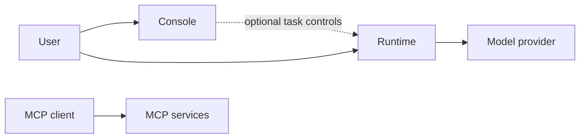

# CAS Platform Handbook

CAS brings together an agent runtime, a web console, and a set of reusable Model Context Protocol (MCP) services. This handbook is an orientation for developers and architects: it identifies the maintained components, their responsibilities, and the limits of the currently evidenced capabilities.

## Repository catalog

| Component | Repository | Responsibility |
| --- | --- | --- |
| Agent runtime | [cas-agent-runtime](https://github.com/alex-kzr/cas-agent-runtime) | Task and scenario execution, provider integration, execution records, and telemetry. |
| Agent console | [cas-agent-console](https://github.com/alex-kzr/cas-agent-console) | Browser interface for inspecting runs and, when explicitly enabled, selected task controls and repository analysis. |
| MCP services | [cas-mcp-services](https://github.com/alex-kzr/cas-mcp-services) | Separately runnable calculator, bounded filesystem and storage tools, and diagnostic fixtures. |

The repositories have independent histories. Consult each repository for its current interfaces, prerequisites, tests, and release status. Access to a repository depends on its own permissions.

## Platform at a glance

The runtime is the execution component and integrates with the Claude Agent SDK. The console is the user-facing application: its default mode reads recorded results without importing runtime internals or requiring runtime credentials. Optional task controls and repository analysis depend on the runtime. The MCP services provide tools for compatible clients and do not themselves execute agents or call a model. Native SDK-to-MCP integration remains unverified.

The dotted connection is optional. The diagram shows component boundaries, not a claim that the runtime is already integrated with every MCP service.

## Capabilities and boundaries

- **Tasks and scenarios:** The runtime supports manual tasks and local validation scenarios. Local validation is evidence about platform checks, not proof of native model behavior. Automatic retries and scheduling are not implemented according to the runtime documentation.
- **History and inspection:** The console displays run history, results, events, usage information, and approved artifacts. Missing native data is identified rather than assumed. Its default mode is read-only.
- **Coding controls:** The console offers opt-in controls for a bounded coding profile. The runtime documentation records a limited native positive result; broader coding variants and native continuation remain unverified.
- **Repository analysis:** The console includes an offline, fixture-backed analysis experience. General arbitrary-repository and live analysis should not be assumed available; live paths described in the component documentation have separate closed gates and readiness limits.
- **Tools:** The MCP services expose calculator and bounded resource operations over standard input/output. Diagnostic fixtures are explicitly enabled. The resource checks are not an operating-system sandbox.

## Integrations and information

The runtime integrates with a model provider through the Claude Agent SDK. MCP services expose a protocol interface for an MCP client. The console reads versioned execution records and can operate independently for inspection. Provider credentials and configuration are deployment-specific and must be managed outside this handbook.

Execution records may include results, events, validation outcomes, usage observations, and approved artifacts. Native and derived usage data have different provenance; absent or incomplete values should not be treated as billing totals. Consult the component repositories for their current data contracts and privacy boundaries.

## Development and operations

Start with the repository that owns the capability being changed. Read its setup and testing guidance, then run the relevant offline checks before considering any live provider activity. The console's default inspection mode does not require runtime credentials; optional controls have additional dependencies. Configuration, credentials, data storage, and access permissions must be chosen for the target environment rather than copied from another installation.

For diagnosis, first identify the affected component and inspect the recorded status, validation outcomes, and available error information. A stopped or interrupted local execution does not by itself establish provider-side cancellation. Review the owning repository's current guidance before attempting recovery. Deployment topology and production readiness are **to be confirmed** for a given environment.

## Glossary

- **CAS:** the platform represented by the components in this handbook.
- **Runtime:** the component responsible for task and scenario execution.
- **Scenario:** a defined validation or research execution supported by the runtime.
- **Run:** a recorded execution and its associated status and observations.
- **MCP:** Model Context Protocol, used by the tool services to communicate with compatible clients.
- **Native:** behavior observed through the actual provider integration, as distinct from fixture or offline validation.
